<!--
  SETUP (visitors never see this comment)
  1. Public repository named exactly: mohammednaeemog-sys
  2. Keep this structure:
         README.md
         assets/banner.svg
         assets/ride.svg
         assets/divider.svg
         assets/activity.svg
  3. Lines marked EDIT are the ones to personalise.
  4. Stats, languages, activity, "More projects" and "Recently active" update
     by themselves every day (.github/workflows/update-profile.yml).

  THEME: every colour below is taken from your three SVGs.
         background #0d1117 | green #3fb950 | light green #7ee787
         text #c9d1d9 | muted #8b949e | border #30363d
-->

<!-- Terminal banner: typing animation, moon, starfield. -->
<p align="center">
  
</p>

<!-- Pixel cowboy riding across the desert. -->
<p align="center">
  
</p>

<!-- EDIT: replace the LinkedIn address, or delete that badge. -->
<p align="center">
  <a href="https://github.com/mohammednaeemog-sys"></a>
  <a href="https://www.linkedin.com/in/mohammed-naeem-bb5589400/"></a>
  <a href="mailto:mohammed.naeem.og@gmail.com"></a>
</p>


## About

```bash
$ whoami
mohammed-naeem  # CSE student, East West University, Dhaka

$ cat focus.txt
machine learning | generative AI | security
```

I am a Computer Science student at East West University, Dhaka, focused on machine learning, generative AI, and security. Alongside my degree, I build local-first AI tools and carry out independent research, from diffusion-based image generation to machine learning models for password security.

## Technical focus

<table>
  <tr>
    <td width="33%" valign="top">
      <b>Machine Learning</b><br />
      <sub>Deep learning <br />Ensemble methods<br />Model evaluation</sub>
    </td>
    <td width="33%" valign="top">
      <b>Generative AI</b><br />
      <sub>Stable Diffusion and ControlNet<br />LoRA adapters<br />Retrieval-augmented generation</sub>
    </td>
    <td width="33%" valign="top">
      <b>Security</b><br />
      <sub>Penetration testing<br />Kali Linux and Metasploit<br />Security-focused machine learning</sub>
    </td>
  </tr>
</table>

<!-- EDIT: only keep topics you are comfortable discussing in an interview. -->

## Tech stack

<p>
  
  
  
  
  
  
  
  
  
  
  
  
  
  
  
  
</p>


## Featured work

<table>
  <tr>
    <td width="50%" valign="top">
      <b><a href="https://github.com/mohammednaeemog-sys/AI-Art-Style-Transfer">AI Art Studio</a></b><br />
      <sub>Personal project</sub><br /><br />
      A local-first image stylization app, with no paid API required.
      <ul>
        <li>18 selectable styles</li>
        <li>Stable Diffusion with Canny ControlNet and LoRA adapters</li>
        <li>Fast neural style models behind a Gradio interface</li>
      </ul>
      
      
      
      <br /><br />
      <a href="https://github.com/mohammednaeemog-sys/AI-Art-Style-Transfer">Source →</a>
    </td>
    <td width="50%" valign="top">
      <b><a href="https://github.com/mohammednaeemog-sys/Password-Strength-Classification-Using-Structural-Features">Password Strength Classification</a></b><br />
      <sub>Machine learning for security</sub><br /><br />
      Classifies password strength from structural features.
      <ul>
        <li>Stacking ensemble learning approach</li>
        <li>Features built from password structure</li>
        <li>Applied machine learning in a security setting</li>
      </ul>
      
      <br /><br />
      <a href="https://github.com/mohammednaeemog-sys/Password-Strength-Classification-Using-Structural-Features">Source →</a>
    </td>
  </tr>
  <tr>
    <td width="50%" valign="top">
      <b><a href="https://github.com/mohammednaeemog-sys/skein-yarn-comparator">Skein: Yarn Diameter Comparator</a></b><br />
      <sub>Research prototype, with <a href="https://github.com/Shimul0150">Jasim Uddin Shimul</a></sub><br /><br />
      Compares the width of two yarns from photos, with camera calibration.
      <ul>
        <li>Otsu and Sauvola segmentation with cross-section width estimates</li>
        <li>Free web edition for phone and desktop; photos never leave the browser</li>
        <li>Python and Streamlit app, plus a JavaScript port with parity tests</li>
      </ul>
      
      
      
      <br /><br />
      <a href="https://mohammednaeemog-sys.github.io/skein-yarn-comparator/">Live demo →</a> · <a href="https://github.com/mohammednaeemog-sys/skein-yarn-comparator">Source →</a>
    </td>
    <td width="50%" valign="top">
      <b><a href="https://github.com/mohammednaeemog-sys/rag-project-bluebook">EWU Bulletin RAG Chatbot</a></b><br />
      <sub>Collaborative work</sub><br /><br />
      Citation-grounded question answering over the university bulletin.
      <ul>
        <li>Retrieval-augmented generation</li>
        <li>Answers cite the bulletin pages they come from</li>
        <li>Forked from a project by <a href="https://github.com/mishkat2025/rag-project-bluebook">mishkat2025</a></li>
      </ul>
      
      <br /><br />
      <a href="https://github.com/mohammednaeemog-sys/rag-project-bluebook">Source →</a>
    </td>
  </tr>
</table>

## More projects

<!-- Updated automatically every day: new public repositories appear here on their own. -->
<!-- AUTO:PROJECTS:START -->
| Project | Description | Technologies |
|:--|:--|:--|
| [**gaach**](https://github.com/mohammednaeemog-sys/gaach) | No description yet. | TypeScript |
| [**Portfolio Website**](https://github.com/mohammednaeemog-sys/portfolio) | Personal portfolio with course materials, published to GitHub Pages by GitHub Actions. | React, Vite, JavaScript |
| [**Penetration Testing Simulation**](https://github.com/mohammednaeemog-sys/Penetration-Testing-and-Remote-Access-Simulation-Using-Kali-Linux-and-Metasploit-Framework) | Simulated penetration test and remote access scenario in a controlled lab environment. | Kali Linux, Metasploit |
| [**CNN Image Classification**](https://github.com/mohammednaeemog-sys/-Image-Classification-Using-Convolutional-Neural-Network) | Image classifier built with a convolutional neural network. | Deep Learning, Jupyter |
| [**COVID-19 Forecasting with RNN, LSTM and GRU**](https://github.com/mohammednaeemog-sys/RRN-WORK) | Exploratory analysis of a COVID-19 dataset and forecasting with recurrent neural networks. | Deep Learning, Jupyter |
<!-- AUTO:PROJECTS:END -->


## Github stats

<!-- Cards drawn by .github/workflows/update-profile.yml every day, in the same colours as the SVGs. -->
<p align="center">
  
  
</p>

<p align="center">
  
</p>

## Contributions

<!-- Contribution calendar in your green. Updates automatically. -->
<p align="center">
  
</p>

<!-- Activity overview chart. Redrawn automatically every day. -->
<p align="center">
  
</p>

<!-- Updated automatically: your three most recently pushed repositories. -->
<!-- AUTO:RECENT:START -->
<p align="center">
  <sub>Recently active in <a href="https://github.com/mohammednaeemog-sys/gaach">gaach</a>, <a href="https://github.com/mohammednaeemog-sys/skein-yarn-comparator">skein-yarn-comparator</a> and <a href="https://github.com/mohammednaeemog-sys/portfolio">portfolio</a></sub>
</p>
<!-- AUTO:RECENT:END -->


<p align="center">
  <sub>Let's build something together. Open to research collaboration and project work in machine learning and security.<br />Reach me at <a href="mailto:mohammed.naeem.og@gmail.com">mohammed.naeem.og@gmail.com</a></sub>
</p>
